# Baliset


**Baliset** is a private, local music player for Android with the iOS 26 liquid-glass look of the [Glass](https://github.com/everettpenne/Glass)
suite. It plays the music already on your phone — no account of ours, no ads, no upload — including the AIFF files an Apple Music library
is made of, keeps the covers tidy (a folder's own art first, then MusicBrainz and the Cover Art Archive when you ask), and hands the
launcher a real media session, so Uno Launcher's dynamic island, media widget, lock screen and control panel can show and control it.
If you run a Jellyfin server, you can also stream and download from it, with an encrypted session and no cloud in between.

It is the listening leg of the suite: Seekur reads Reddit, Spice plays Jellyfin, Thumper plays podcasts and feeds, Sietch opens files,
and Baliset plays the songs that are simply *there*.

<p align="center">
  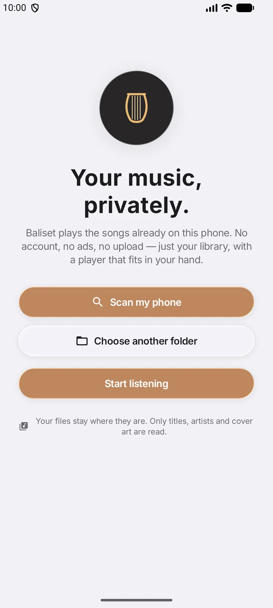
  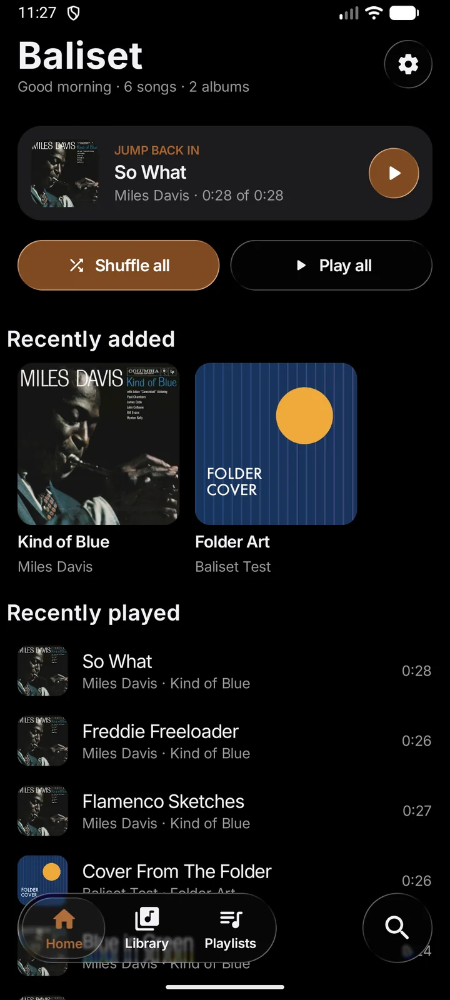
  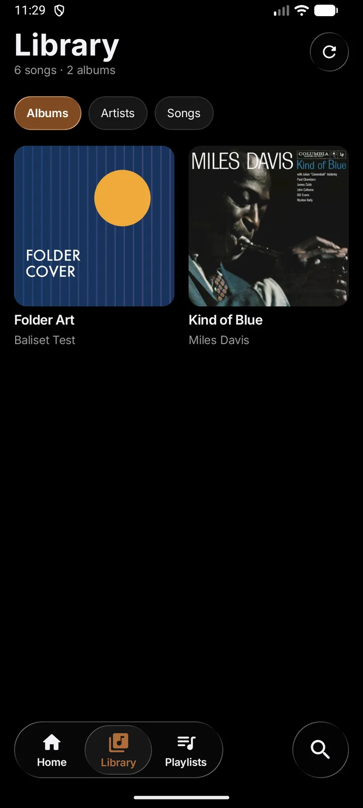
  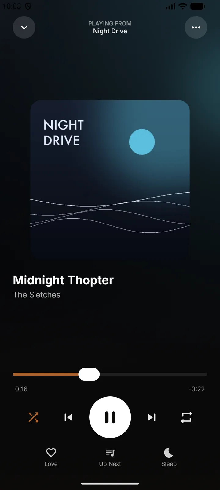
</p>
<p align="center">
  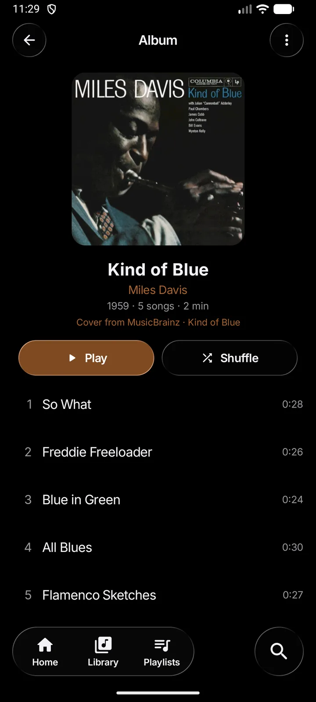
  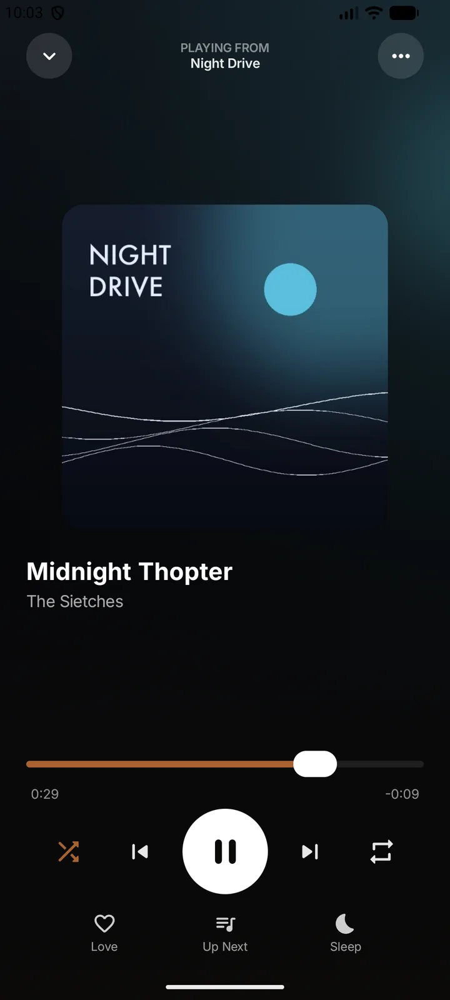
  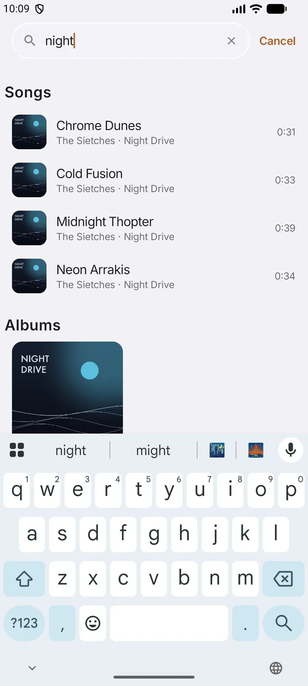
  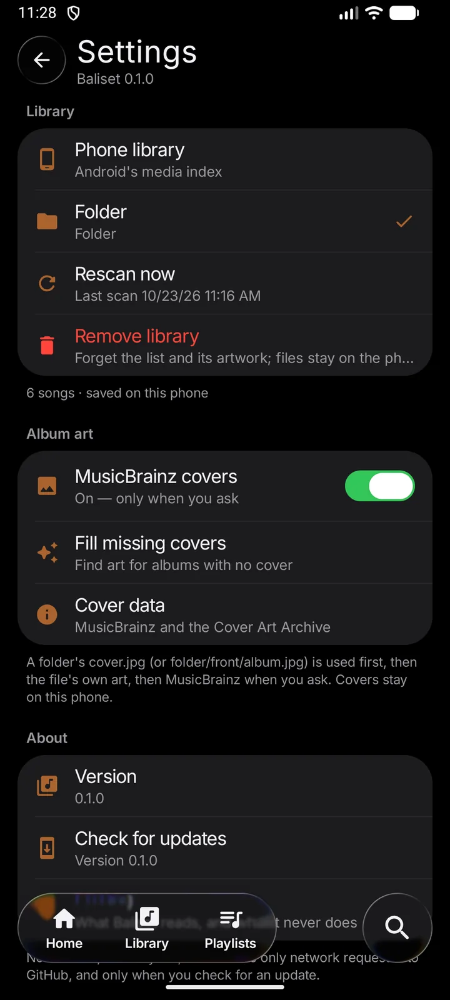
  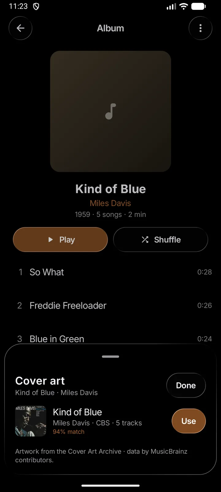
</p>
<p align="center">
  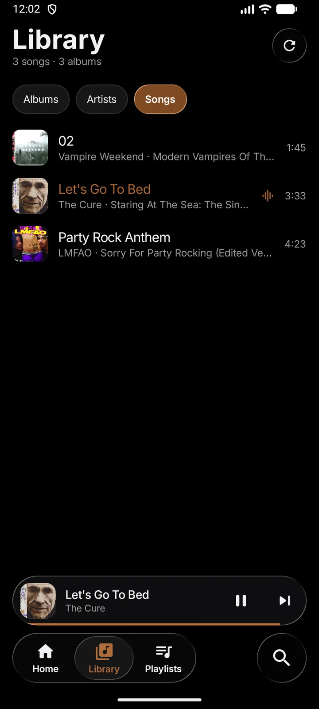
  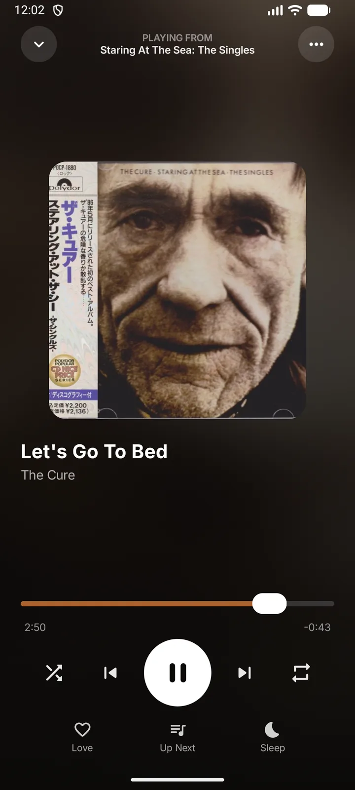
</p>
<p align="center">
  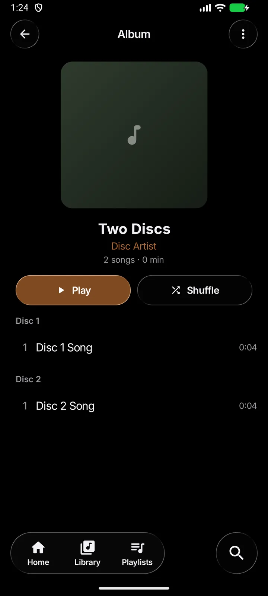
  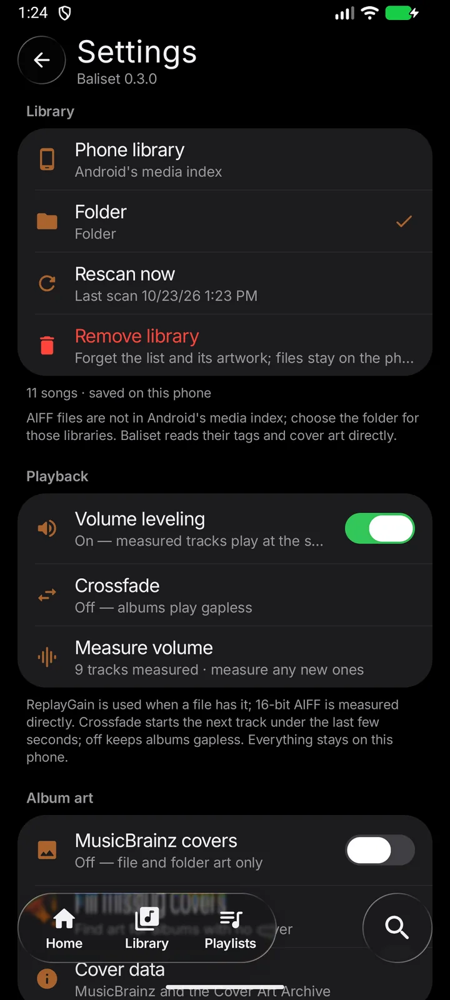
  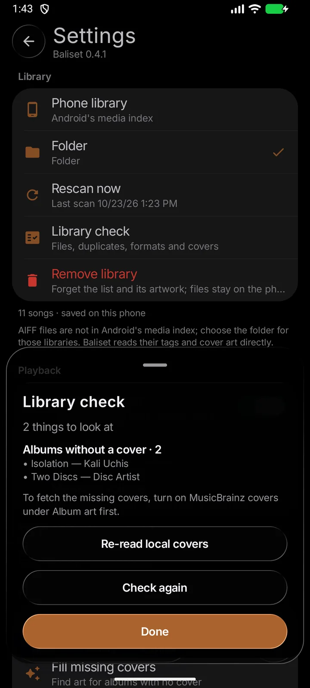
</p>
<p align="center">
  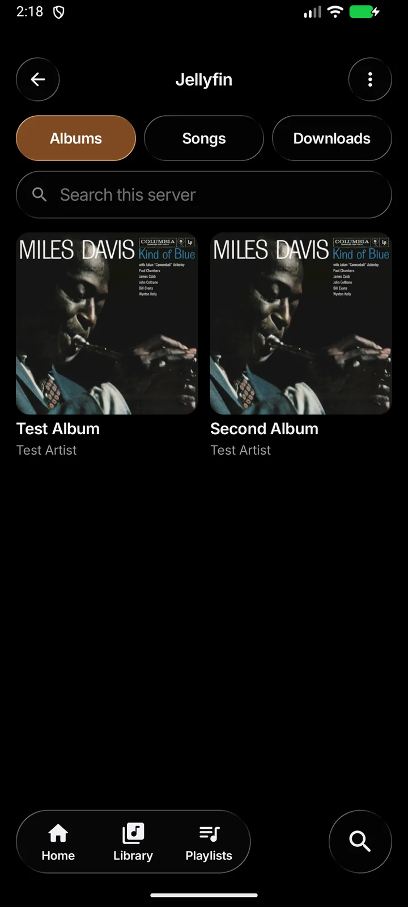
  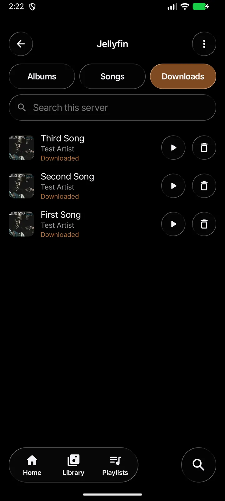
</p>

## What it does

- **Your library, two ways.** Read Android's media index with one audio permission, or hand Baliset a folder in the system picker and
  it reads only that folder — no storage permission at all. Tags (title, artist, album, disc, year, length) and embedded cover art are
  read on the phone; untagged files get a sensible name from their file name and a cover-shaped placeholder.
- **AIFF, the Apple Music kind.** Android's media stack has no AIFF support, so Baliset reads the FORM/COMM/SSND chunks and the
  ID3 tag itself: titles, artists, albums, years, track numbers, lengths and the embedded cover all come straight from the file,
  and a small Media3 extractor plays 16-bit PCM in both the usual big-endian AIFF and little-endian `sowt` AIFC, with seeking and
  queue transitions. No conversion, no copies, no network. (Android's media index does not list AIFF, so use **Choose a
  folder** for these libraries.)
- **Albums, with their guests.** A folder is one album, and an album-artist tag (TPE2) always wins over the track credit. "Kali Uchis
  Feat. Tyler, the Creator" and "Kali Uchis" share one album; the album shows "Kali Uchis", not six variants. Disc numbers (TPOS) are
  read too, so a two-disc set is sorted and headed Disc 1 / Disc 2, and a "Various Artists" album is not linked to one artist.
- **Your own Jellyfin server, when you want it.** Sign in once (the token is encrypted with Android's Keystore), browse the server's
  albums and songs, and play the original files through the same ExoPlayer session. The token travels in an `Authorization` header,
  never in a stream URL. Download an album or a song with real progress and retry, then play it with the server off. Baliset does not
  transcode: it asks for the original file, so a format the phone cannot decode will not play. Reach it from **Settings → Server →
  Jellyfin**, the server icon on Home, or a `baliset://jellyfin` link.
- **A library check that tells the truth.** One read-only audit for files that vanished, formats Android cannot decode (WMA, APE, MPC, DSD, FairPlay `.m4p`, compressed AIFF), duplicate groups, albums without a cover, tracks that only have a file name, and zero-length files. It can hand the coverless albums to MusicBrainz, or re-read the local covers, but it never deletes or edits anything.
- **One loudness.** Volume leveling reads ReplayGain when a file has it, measures 16-bit AIFF PCM directly, and decodes MP3s (and other
  compressed files) once with the platform codec. A target RMS of −18 dBFS and a peak ceiling keep quiet rips up and loud masters
  down without clipping. Measuring is an explicit action with progress and Stop; the correction is stored only on the phone.
- **Crossfade, or gapless.** Choose 3, 5, 8 or 12 seconds and the next track starts under the last seconds of the current one: a second
  ExoPlayer ramps in while the first ramps out, and the session switches at the end. Off keeps the original gapless path. Audio focus
  is managed once for both players, so calls and other apps still pause and duck the music.
- **A player that keeps playing.** A Media3 `MediaSessionService` owns the sound: background playback, a media notification you can
  control, lock-screen and headset buttons, audio focus, "pause when headphones disconnect", gapless consecutive tracks, and a
  "previous restarts the song once it is past three seconds" rule.
- **A queue you can see and shape.** Shuffle and repeat (off / all / one), drag any song to a new place in Up Next, remove one with ×,
  or clear the queue. Shuffle is the app's own order, so the page always shows what will really play.
- **Playlists and favourites.** Make a list, add songs from anywhere with a long press, rename or delete it, and keep a heart on the
  tracks you love. Both live only on the phone.
- **Jump back in.** The last song is offered where it stopped, and Recently played keeps the last ten.
- **Covers that keep themselves.** A `cover.jpg` (or folder/front/album/artwork) beside the music wins, then the file's own art;
  when an album has neither, **Find cover art** on the album searches MusicBrainz, shows the candidate releases with a match
  confidence, and downloads the chosen front cover from the Cover Art Archive. **Settings → Album art → Fill missing covers** does
  the safe cases for the whole library, one request a second, and only writes a confident match.
- **A friendly Now Playing.** Blurred cover, a scrubber you can drag, five controls in the usual places, Up Next, a sleep timer
  (15 / 30 / 45 / 60 minutes, or the end of the track) and a menu to reach the album, the artist or a playlist.
- **Search as you type** across songs, albums and artists, with accents and case ignored and the best matches first.
- **The launcher's island, for free.** Baliset publishes the title, artist, album, cover bitmap and duration on its media session. Uno
  Launcher reads exactly those, so the island's playing card, the media widget, the control panel and the paused-track memory all work
  with no launcher code and no special integration.

## Covers and MusicBrainz

Covers are kept as one small JPEG per album in the app's private storage, in this order:

1. an image beside the music named `cover`, `folder`, `front`, `album`, `albumart`, `artwork` or `thumb` (jpg, jpeg, png, webp or bmp);
2. Android's thumbnail of the file (its embedded cover);
3. a cover you pick from MusicBrainz.

To use the last one, open an album, tap ••• → **Find cover art**. The first time it explains what will be sent; after that it searches
MusicBrainz for the album's title and artist, ranks the editions against the track count and year, and shows up to four candidates
with a small preview and a match percentage. Nothing is written until you tap **Use**. The album then says **Cover from MusicBrainz**
under its title, and ••• → **Reset cover** puts it back the way the files have it.

**Settings → Album art** has the switch (off until you ask), **Fill missing covers** for the library-wide pass (only albums with no
cover, only matches of 74% or better, with progress and Stop), and the data credits.

Matching is honest about what it is: title, artist, track count and year, with the release group's artwork because editions share
it. It is very good for well-documented albums and deliberately cautious elsewhere — a wrong cover is worse than a placeholder.
Nothing is ever written into your music files. The only network traffic is to `musicbrainz.org` and `coverartarchive.org`, one
request a second, with a `User-Agent` that names the app.

## Install

**[Download the latest APK](https://github.com/everettpenne/Baliset/releases/latest)**: on the release page expand **Assets** and tap
the `.apk`.

Android 12 or later (minSdk 31, targetSdk 36). It is a normal sideloaded app; nothing is published to a store. Updates are signed with
one key, so a new release installs over the old one. Baliset can check GitHub for you (**Settings → Check for updates**) and hands the
download to Android's installer, which always asks first.

## How to use

| To do this | Do this |
| --- | --- |
| Give it music | **Scan my phone** (one audio permission) or **Choose a folder** (no permission, only that folder) |
| Play something | Tap a song, an album, **Play**, **Shuffle**, or **Shuffle all** on Home |
| Change what plays next | Hold a song → **Play next** / **Add to queue**; open **Up Next** to drag or remove |
| Keep a song | Hold it → **Add to favourites**, or tap the heart in the player |
| Make a playlist | **Playlists → +**; then hold any song → **Add to playlist** |
| Jump to the album or artist | Hold a song, or use the ••• menu in the player |
| Sleep | In the player tap **Sleep**, and choose a length or the end of the track |
| Rescan or change source | **Settings → Rescan now**, or the Folder row to choose another folder |
| Fix a missing cover | Album ••• → **Find cover art**, or **Settings → Album art → Fill missing covers** |
| An AIFF / Apple Music library | **Choose a folder** with the library; Android's media index does not list AIFF |
| Jellyfin | **Settings → Server → Jellyfin**, enter the address and sign in; browse, stream and download |

## Glass

The interface is the shared [Glass](https://github.com/everettpenne/Glass) kit: `GlassScreen`, the floating tab bar, glass sheets,
menus and sliders, the HIG type scale in Inter, and the suite's player controls (`PlayerScrubber`, `PlayerTransport`, `PlayButton`).
Baliset is built with the version in `glass.version` via a composite build:

```kotlin
// settings.gradle.kts
includeBuild("../Glass")
```

This release also adds three pieces to Glass that the suite was missing, used here and ready for Seekur, Spice and Thumper:

- `glass/GlassRows.kt`: `GlassSectionHeader`, `GlassGroup`, `GlassListRow`, `GlassRowDivider`, `GlassSearchField`, `GlassEmptyState`.
- `media/MiniPlayer.kt`: `GlassMiniPlayer`, the now-playing capsule with a progress hairline.

## Build

JDK 17 or 21, Android SDK 36, and the Glass checkout next to this one (`../Glass`). The wrapper is included.

```sh
./gradlew :app:testDebugUnitTest :app:assembleDebug
```

The debug APK is at `app/build/outputs/apk/debug/app-debug.apk`. Release builds take their signing from the environment and are unsigned
without it: `BALISET_RELEASE_STORE_FILE`, `BALISET_RELEASE_STORE_PASSWORD`, `BALISET_RELEASE_KEY_ALIAS`,
`BALISET_RELEASE_KEY_PASSWORD`. The signing key is deliberately outside the repository.

## Status and limits

- **Baliset is a working name** for the app; the package id is `com.everettpenne.baliset`.
- Version 0.5.0. It has been built and exercised on an emulator (1080 × 2400, Android 17 / API 37) with sample music, in light and
  dark themes; **it has not been run on a physical phone or a GrapheneOS device.**
- Artwork was tested through the update: a cover cached under an old album key was adopted and shown, and a deliberately deleted cover
  was re-read from the MP3's own tags. The library check reported the two albums that genuinely have no cover and nothing else.
- Album identity was exercised with six guest-credited *Isolation* tracks (one album, "Kali Uchis"), a two-disc album (Disc 1 / Disc 2
  headers and numbers), and the normal single-artist albums. Volume measurement covered 2 AIFFs and 7 MP3s in one pass, and a 5-second
  crossfade from a 3:33 AIFF into the MP3 moved the session and the UI to the next track, then paused, resumed and skipped normally.
- Jellyfin was exercised against a local mock server: sign-in, the music library, album art, direct streaming through ExoPlayer,
  three downloaded tracks with progress, and playback with the mock server stopped. A real Jellyfin install was not available here.
- The code has 79 JVM tests, including the AIFF/ID3 readers, album grouping, loudness math and the gain processor.
- Jellyfin streaming is direct-play only (no transcode fallback); downloads run while Baliset's process is alive and resume from the
  Downloads list, not in the background after the process is killed. Only the first music library on a server is shown.
- The crossfade engine and its manual audio focus were tested on the emulator; phone-call and headphone focus changes were not.
  An album split across separate folders (one folder per disc) still appears as separate albums; a single folder with disc tags works.
- The cover lookup was exercised live against MusicBrainz and the Cover Art Archive (Kind of Blue, 94% match), as was the
  folder-cover order. MusicBrainz coverage is uneven for very new, very local and some classical releases; the candidate sheet is
  there for those.
- AIFF was exercised with real files from a library of 790 AIFFs and 47 MP3s: 16-bit big-endian `.aif` and little-endian `sowt`
  `.aiff`, including their ID3 tags, embedded covers, lengths, playback, seeking and next/previous. 24-bit and floating-point AIFF
  use the same extractor but were not exercised; compressed AIFF variants (`ima4`, `alaw`, `ulaw`) are rejected. Android's media index
  cannot see AIFF at all, so the folder source is required.
- WMA, APE, MPC, DSD, and FairPlay `.m4p` are still out of scope; the library had none of them.
- The phone-index route is implemented, but the test emulator's media index exposed the pushed files without tags or `is_music`, so the
  screenshots use the folder route (the same scanner, reading each file's tags). On a phone whose index is populated, **Scan my phone**
  reads it; if the index is empty, the welcome page points you at **Choose a folder**.
- No home-screen widget yet. The island, notification and lock-screen controls are the system surfaces Baliset uses today.
- Playlists, favourites and the library list are not exported; making a backup is a future feature. Clearing the app's storage forgets
  them; the music files are untouched.

## Credits and licence

MIT, see [LICENSE](LICENSE). Baliset is an independent project, not affiliated with Apple, Google or GrapheneOS. The glass recipe is
[Backdrop](https://github.com/Kyant0/AndroidLiquidGlass) (Apache-2.0); playback is AndroidX Media3; type is Inter (SIL OFL 1.1). See
[THIRD_PARTY_NOTICES.md](THIRD_PARTY_NOTICES.md) and [PRIVACY.md](PRIVACY.md).
